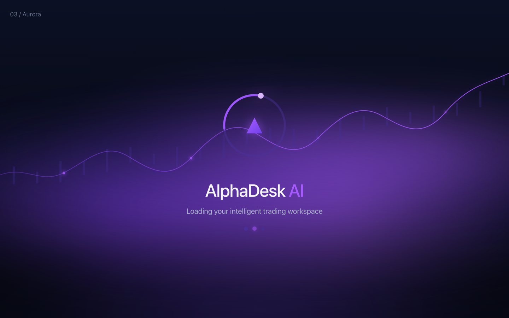
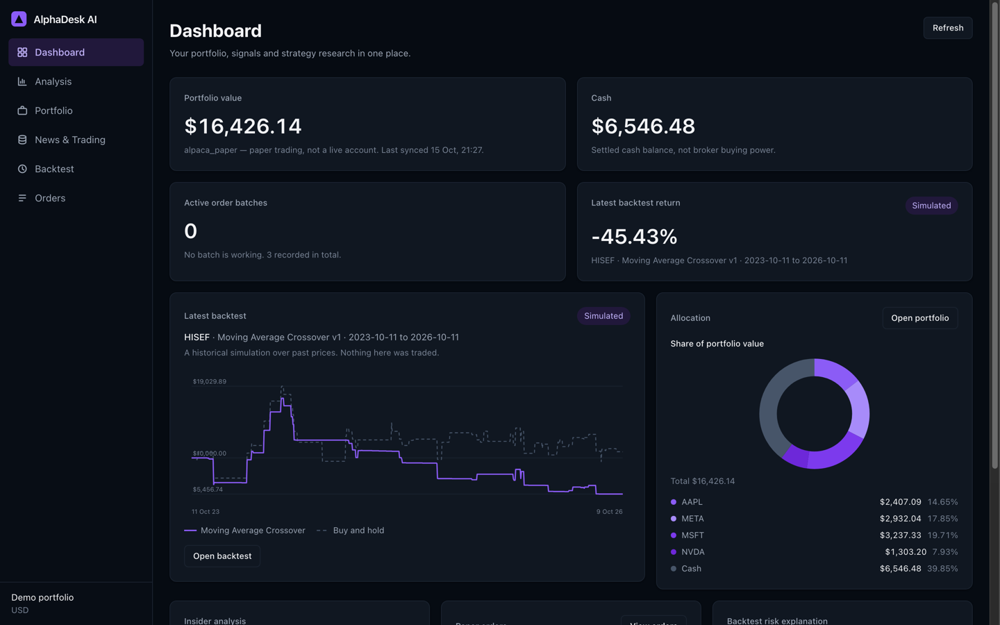
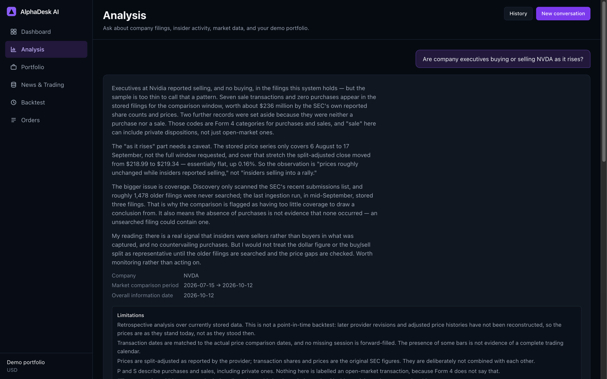
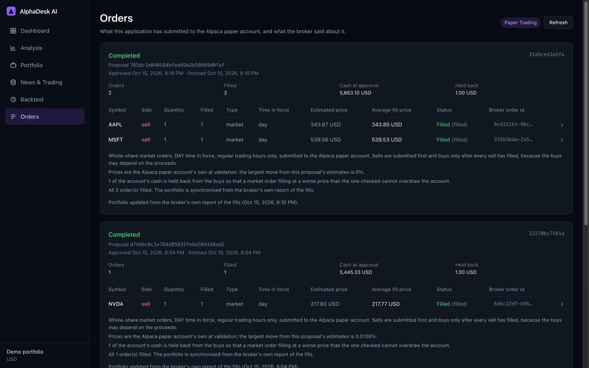
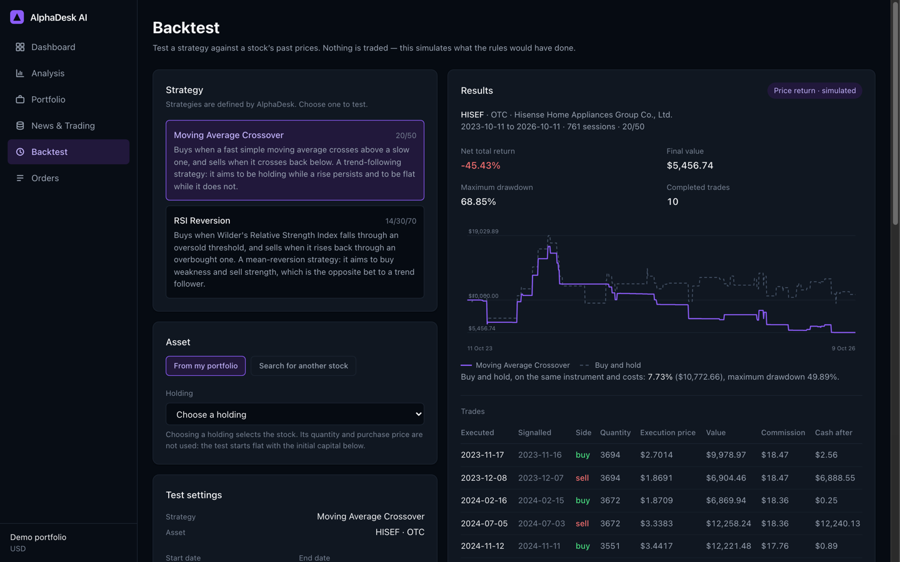
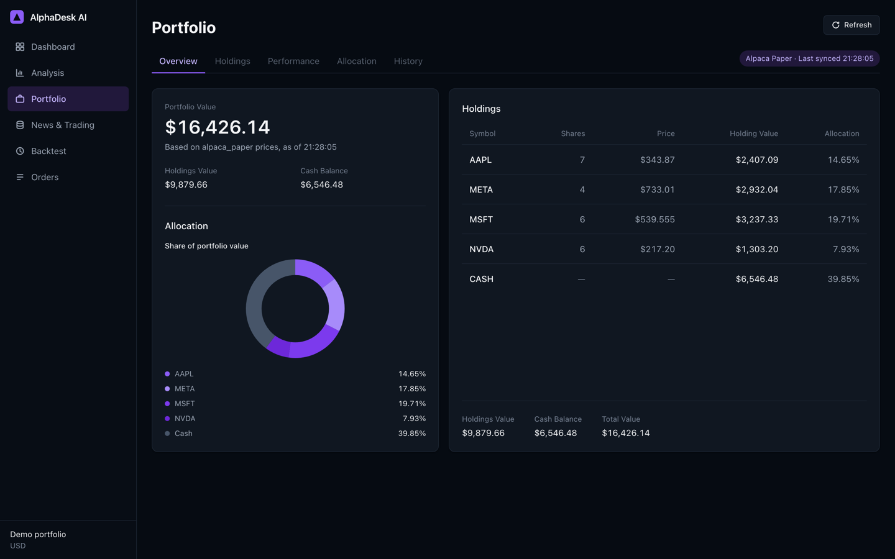
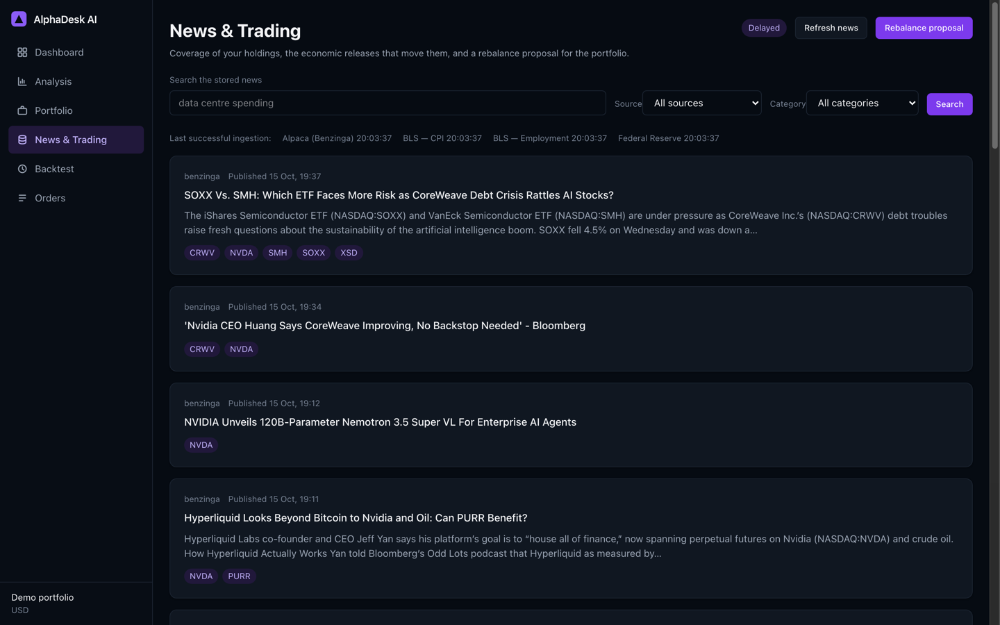
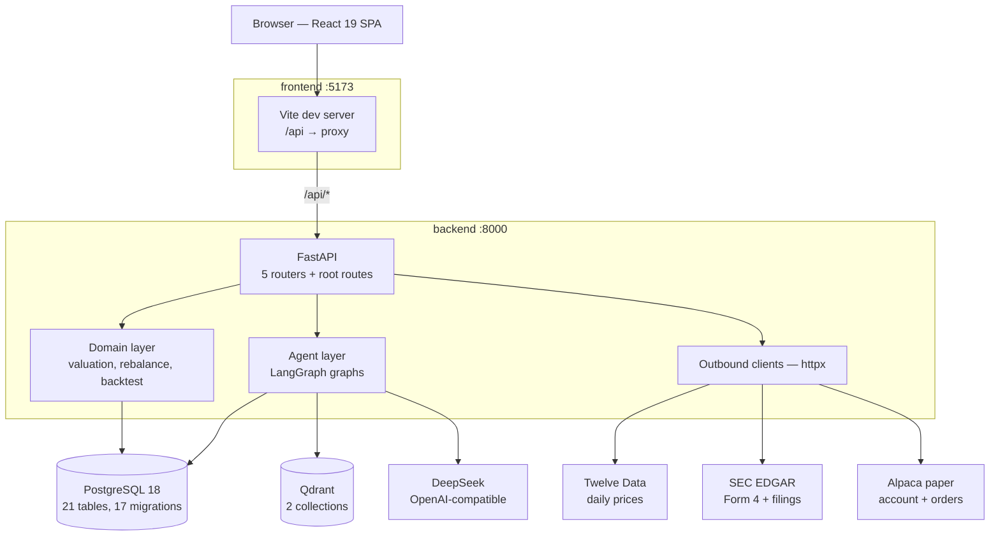
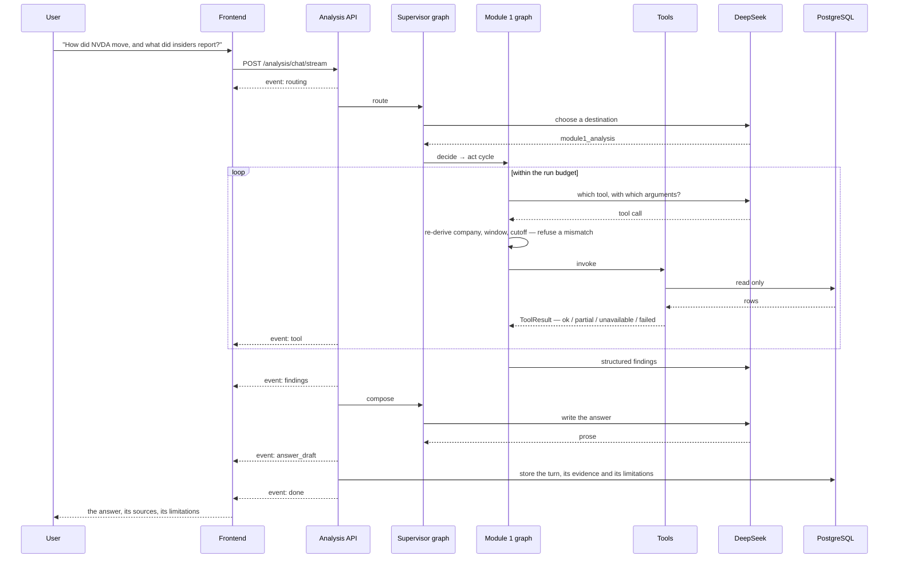

# AlphaDesk AI

**An autonomous quant and investment analytics platform — where the model reads and writes, and the code decides what is true.**

AlphaDesk answers questions about US-listed companies from data it has actually stored: daily prices, SEC Form 4 insider transactions, reported financial figures, and the full text of SEC filings. It proposes portfolio rebalances and executes them against an Alpaca **paper** account, but only after a person approves. It backtests two strategies over historical sessions and explains what happened.

Every part of it is built on one rule: **the model never decides a fact this application can look up.** A model chooses which tool to call and writes the prose. The company, the date window, the information cutoff, the arithmetic, the tool results and the trading gate all come from code.




---

## Table of contents

- [What it does](#what-it-does)
- [Screenshots](#screenshots)
- [Architecture](#architecture)
- [How a question gets answered](#how-a-question-gets-answered)
- [Tech stack](#tech-stack)
- [Quick start](#quick-start)
- [Configuration](#configuration)
- [Testing](#testing)
- [Project structure](#project-structure)
- [Design decisions](#design-decisions)
- [Known limitations](#known-limitations)
- [Documentation](#documentation)
- [License](#license)

---

## What it does

Three modules, one shell.

### Module 1 — Insider activity against price

Ask about a company over a date window. The agent picks from four read-only tools, gathers what it needs, and answers with the evidence it used.

| Tool | What it returns |
|---|---|
| `market_insider_analysis` | The price move over the window and the Form 4 insider transactions in it, with the rows that were **excluded** and why |
| `company_financial_facts` | One reported figure — revenue, net income, total assets, total liabilities or cash — as the company's own SEC filing reported it |
| `filing_evidence_search` | Passages from the company's indexed filings, retrieved by similarity, each with its accession number, section and source URL |
| `portfolio_context` | Whether the demo portfolio holds a symbol, how much, and what the portfolio is worth |

Tool results carry one of four statuses: `ok`, `partial`, `unavailable`, or `failed`. **`unavailable` is an answer, not an error** — it means the call ran correctly and this system holds nothing that answers it. The model is told to report it as such, never as a zero.

### Module 2 — Portfolio rebalance, approval, execution

Reads the portfolio and the news corpus, proposes target allocations with a rationale and the trades it would take to get there, and **stops**. Generating a proposal sends nothing anywhere. An approval is a separate, deliberate act, and it is the only path in the application by which an order can come to exist; submission happens afterwards, from a background thread, with an idempotency key per order.

### Module 3 — Backtesting

Two strategies — Moving Average Crossover and RSI Reversion — simulated over historical sessions with commission and slippage, executed at the next session's open. The exact bars a run consumed are stored with it, so a saved run can be explained months later without the provider's history having moved underneath it. No route in this module can reach a broker.

---

## Screenshots

| Dashboard | Analysis |
|---|---|
|  |  |

| Orders | Backtest |
|---|---|
|  |  |

| Portfolio | News & Trading |
|---|---|
|  |  |

---

## Architecture



The frontend holds **no API base URL and no environment variables**. Every call is a relative `/api/...` path that the Vite dev server proxies to `backend:8000` over the Compose network, so there is no CORS configuration and the backend's hostname never reaches the browser.

What the agent can reach is deliberately narrow: **four read-only tools over PostgreSQL and Qdrant, and the LLM endpoint. Nothing else.** Every path that touches the outside world — price ingestion, SEC ingestion, broker sync, backtests — is triggered by a person or a scheduled command, never by the model.

---

## How a question gets answered



Streaming is Server-Sent Events. The run executes on its own thread and publishes events through a bounded queue, so **closing the browser tab does not stop the run** — it only stops anyone watching it.

A run is bounded by `RunBudget`: 12 model requests, 10 tool calls, a deadline, and a token ceiling. An infinite agent loop is not possible, because the thing that ends it is a resource ceiling rather than a property of the loop.

---

## Tech stack

| Layer | Choice |
|---|---|
| **Backend** | Python 3.12, FastAPI 0.141, SQLAlchemy 2.0, Pydantic v2, Alembic (17 hand-written migrations), uvicorn |
| **Agent** | LangGraph 1.2 (StateGraph, checkpointing), OpenAI SDK 2.x pointed at DeepSeek's OpenAI-compatible endpoint |
| **Retrieval** | FastEmbed (`BAAI/bge-small-en-v1.5`, 384 dimensions, local ONNX), Qdrant with cosine distance, custom chunking |
| **Data** | PostgreSQL 18, JSONB for tool payloads and run snapshots |
| **Frontend** | React 19, Vite 8, TypeScript 7, Tailwind CSS v4 (no `tailwind.config.js` — tokens live in `@theme`), Vitest + Testing Library |
| **Infrastructure** | Docker Compose: postgres, backend, qdrant, frontend |

Two deliberate absences are worth naming, because both are load-bearing:

- **No LangChain.** `langgraph` is the only orchestration library. The agent's judgement is written out in `backend/app/agent/module1.py` rather than hidden inside a framework's `AgentExecutor`, which is what makes every step in it readable and testable.
- **No Redis.** The application is single-process and low-traffic; an in-run tool cache and FastEmbed's disk cache cover what caching it needs.

---

## Quick start

**Requirements:** Docker Desktop, and (optionally) API keys. The stack starts without any of them — every key has an empty default, so the application comes up and the features that need a provider report `unavailable` rather than failing to boot.

```bash
git clone https://github.com/ilkincoder/AlphaDesk-AI-Autonomous-Quant-and-Investment-Analytics-Platform.git
cd AlphaDesk-AI-Autonomous-Quant-and-Investment-Analytics-Platform

cp .env.example .env          # fill in whichever keys you have
docker compose up -d
docker compose exec backend alembic upgrade head
docker compose exec backend python -m app.seed
```

Check it came up:

```bash
curl -s localhost:8000/health      # {"status":"ok"}
curl -s localhost:8000/health/db   # {"status":"ok","database":"connected"}
curl -s localhost:8000/portfolio/valuation
```

- **Application** — <http://localhost:5173>
- **API documentation** — <http://localhost:8000/docs>
- **Qdrant dashboard** — <http://localhost:6333/dashboard>
- **PostgreSQL** — `localhost:5433` (5433, not 5432, so a local PostgreSQL can keep the default port)

### Loading data

The analysis tools read stored data, so there is nothing to analyse until it has been ingested. With `TWELVE_DATA_API_KEY` and `SEC_USER_AGENT` set:

```bash
docker compose exec backend python -m app.fetch_prices       # daily prices from Twelve Data
docker compose exec backend python -m app.fetch_sec          # Form 4 filings from SEC EDGAR
docker compose exec backend python -m app.index_filings      # chunk + embed into Qdrant
docker compose exec backend python -m app.ingest_company     # a company's filings and facts
```

The first embedding run downloads the FastEmbed model once, into the `model_cache` volume.

> **`fetch_sec` requires `SEC_USER_AGENT`.** The SEC asks callers to identify themselves, and the client refuses the placeholder value.

---

## Configuration

Everything is read from `.env` at the repository root. Only the names are listed here; `.env.example` documents each one.

| Variable | Used for |
|---|---|
| `POSTGRES_USER`, `POSTGRES_PASSWORD`, `POSTGRES_DB` | Composed into `DATABASE_URL` |
| `TWELVE_DATA_API_KEY` | Daily prices |
| `SEC_USER_AGENT` | SEC EDGAR and XBRL company facts |
| `ALPACA_API_KEY_ID`, `ALPACA_API_SECRET_KEY` | Paper account sync, news, order submission |
| `ALPACA_BASE_URL` | Alpaca endpoint (defaults to the paper host; non-paper hosts are refused in code) |
| `DEEPSEEK_API_KEY` | The LLM |
| `DEEPSEEK_MODEL` | Model name |
| `DEEPSEEK_BASE_URL` | Provider endpoint |

| Variable | Used for | Default |
|---|---|---|
| `DATABASE_URL` | SQLAlchemy connection | set by Compose |
| `FASTEMBED_CACHE_PATH` | Where the embedding model is cached | `/models/fastembed` |
| `QDRANT_URL` | Vector store | `http://qdrant:6333` |
| `QDRANT_COLLECTION`, `QDRANT_NEWS_COLLECTION` | Collection names | `sec_filings`, `news` |

---

## Testing

Both suites run **inside their containers**.

```bash
# Backend — 60 files, unittest, 1645 tests
docker compose exec backend python -m unittest discover -s tests -t .

# Frontend — 12 files, Vitest, 262 tests
docker compose exec frontend npm test
docker compose exec frontend npm run typecheck
```

The backend suite is unusual in one respect worth knowing: `backend/tests/testdb.py` derives a separate database by appending `_test` to `DATABASE_URL`, **builds its schema by running the real Alembic migrations**, and rolls every test back. The tests exercise the schema that ships, not a hand-written approximation of it.

Everything external is stubbed. Twelve Data and SEC clients are driven through `httpx.MockTransport`, filing retrieval runs against an in-memory Qdrant with a deterministic embedding double, and the language model is replaced by scripted doubles in `backend/tests/agent_doubles.py`. No test makes a network call or spends a token.

---

## Project structure

```text
.
├── docker-compose.yml          # postgres, backend, qdrant, frontend
├── .env.example                # every setting, no secrets
│
├── backend/
│   ├── alembic/versions/       # 17 hand-written migrations
│   ├── app/
│   │   ├── agent/              # LangGraph graphs, prompts, budget, LLM client
│   │   ├── tools/              # the four tools the agent may call
│   │   ├── *_api.py            # routers
│   │   ├── models.py           # 21 tables
│   │   └── ...                 # ingestion, domain logic, broker clients
│   └── tests/
│
├── frontend/
│   └── src/
│       ├── components/         # pages and their pieces
│       ├── api.ts              # the one place the frontend talks to the backend
│       └── index.css           # design tokens + animations
│
└── docs/screenshots/
```

---

## Design decisions

Four choices explain most of the codebase.

**1. The model proposes; the code disposes.** The supervisor's routing is a model call, but whether this system holds a company is a database lookup — so `company_not_stored` is applied *before the router is consulted*. A tool call is re-checked against the run's company, window and cutoff before it executes, and the information cutoff can be pulled earlier but never later. A prompt is a request; the code around it is what makes it a rule.

**2. Missing data is reported, not defaulted.** Every tool returns a typed envelope with a status and a reason code. `unavailable` means "the call ran and this system holds nothing that answers it", and it is what gets reported — never a zero, never an estimate, and never a reason to quietly answer about a different company.

**3. Money is a string, everywhere.** Every amount and percentage in the API is a decimal serialised as a string, and the browser only ever formats them. The reason is JavaScript: a `number` is a binary float, and `0.1 + 0.2` is not `0.3`. All arithmetic happens in Python `Decimal` against PostgreSQL `NUMERIC`.

**4. Nothing trades without a person.** Generating a proposal writes a row and stops. The only route that can create an order is a recorded approval, and the approval is a real LangGraph `interrupt()` held in a PostgreSQL checkpointer — so an interrupted run is resumable, and an approval that was never given has no representation in the database at all.

Alongside those: **every animation is scoped to the component that owns it** (`.aurora-splash*`, `.market-pulse-*`, `.approval-*`), so no CSS rule in `index.css` reaches outside its own subtree.

---

## Known limitations

- **No authentication.** This is a local, single-user application. Conversations are not an authorization boundary, and it is not safe to expose on a public network as it stands. Every published port is bound to `127.0.0.1` for that reason: the host port exists for a tool on this machine, never for the network.
- **Paper trading only.** The Alpaca client refuses any host but the paper endpoint. No real money can be moved.
- **No deployment configuration.** There is no CI, no reverse proxy, and no cloud manifest; the frontend container runs the Vite dev server. It is built and tested as a workstation application.
- **Module 1 runs are not resumable.** Only rebalance proposals and approvals are checkpointed; an analysis interrupted mid-run is simply lost.
- **Retrieval has no re-ranker.** Cosine similarity over 400-token chunks, with over-fetch and validation, is the whole ranking.
- **Ingestion is partial by design.** Form 4 discovery covers the SEC's recent submissions list; the coverage gap is measured and reported with the data rather than hidden. There is no 13F or institutional-holdings support.
- **Backtests read live data at run time.** A run does not read the stored `daily_prices` table — it fetches bars from the provider and freezes them into the run's own snapshot.

---

## Documentation

| Document | What it is |
|---|---|
| `backend/tests/fixtures/sec/README.md` | Provenance of the SEC Form 4 fixtures, including which one is a real filing and where it came from |
| `backend/app/agent/prompts.py` | The prompts themselves, with the reasoning for each rule beside it |

---

## License

No license has been chosen for this project. It is published as a portfolio and coursework project; if you would like to use it, please open an issue.
